# ۳. نمودار رابطه موجودیت‌ها (ERD)

نمودار زیر موجودیت‌های اصلی و کلیدهای خارجی را نشان می‌دهد. برای خوانایی، جدول‌های کمکی
(تصاویر، پنجره‌های دسترس‌پذیری، زیرساخت صف) حذف شده‌اند.

```mermaid
erDiagram
    USERS ||--o{ USER_ROLES : has
    ROLES ||--o{ USER_ROLES : grants
    ROLES ||--o{ ROLE_PERMISSIONS : contains
    PERMISSIONS ||--o{ ROLE_PERMISSIONS : in
    USERS ||--o{ SESSIONS : opens
    USERS ||--o{ AUDIT_LOGS : performs
    USERS ||--o{ APPROVAL_REQUESTS : requests
    USERS ||--o| EMPLOYEES : profile

    DEPARTMENTS ||--o{ EMPLOYEES : staffs
    FLOORS ||--o{ AREAS : contains
    FLOORS ||--o{ DINING_TABLES : holds
    AREAS ||--o{ DINING_TABLES : groups
    DINING_TABLES ||--o{ TABLE_SESSIONS : opens
    TABLE_SESSIONS ||--o{ TABLE_MERGE_MEMBERS : joins
    FLOORS ||--|| FLOORPLANS : has
    FLOORPLANS ||--o{ FLOORPLAN_OBJECTS : contains
    FLOORPLAN_OBJECTS ||--o{ CHAIRS : places
    FLOORPLANS ||--o{ FLOORPLAN_VERSIONS : history

    CATEGORIES ||--o{ PRODUCTS : contains
    PRODUCTS ||--o{ PRODUCT_VARIANTS : has
    PRODUCTS ||--o{ OPTION_GROUPS : offers
    OPTION_GROUPS ||--o{ PRODUCT_OPTIONS : lists
    PRODUCTS ||--o{ PRODUCT_EXTRAS : allows
    EXTRAS ||--o{ PRODUCT_EXTRAS : used
    PRODUCTS ||--o{ RECIPES : defined_by
    RECIPES ||--o{ RECIPE_ITEMS : uses
    INGREDIENTS ||--o{ RECIPE_ITEMS : measured
    INGREDIENTS ||--o{ STOCK_MOVEMENTS : moves
    SUPPLIERS ||--o{ PURCHASES : supplies
    PURCHASES ||--o{ PURCHASE_ITEMS : includes

    CAMPAIGNS ||--o{ QR_CODES : promoted_by
    CAMPAIGNS ||--o{ CAMPAIGN_TARGETS : restricts
    DINING_TABLES ||--o{ QR_CODES : printed_on
    CAMPAIGNS ||--o{ CAMPAIGN_REDEMPTIONS : redeemed

    DINING_TABLES ||--o{ ORDERS : serves
    TABLE_SESSIONS ||--o{ ORDERS : within
    ORDERS ||--o{ ORDER_ITEMS : contains
    ORDER_ITEMS ||--o{ ORDER_ITEM_OPTIONS : configures
    ORDER_ITEMS ||--|| PREP_TASKS : queued_as
    ORDERS ||--o{ ORDER_EVENTS : history
    ORDERS ||--o{ BILLS : billed
    BILLS ||--o{ PAYMENTS : settled_by
    BILLS ||--o{ BILL_SPLITS : split_into
    CASH_REGISTERS ||--o{ PAYMENTS : collects
    ORDERS ||--o{ TERMINAL_REQUESTS : device_request

    DINING_TABLES ||--o{ CUSTOMER_REQUESTS : asks
    DINING_TABLES ||--o{ RESERVATIONS : booked
    CUSTOMERS ||--|| LOYALTY_ACCOUNTS : owns
    CUSTOMERS ||--o{ LOYALTY_LEDGER : earns
    CUSTOMERS ||--o{ WALLET_LEDGER : spends

    ORDERS ||--o{ PRINT_JOBS : prints
    PRINTERS ||--o{ PRINT_JOBS : executes
    USERS ||--o{ NOTIFICATIONS : receives
```

## یادداشت‌های رابطه

- `orders` هم به `dining_tables` و هم به `table_sessions` وصل است: سفارش بیرون‌بر میز ندارد.
- `prep_tasks` یک‌به‌یک با `order_items` است؛ هر آیتم مستقل آماده می‌شود و کل سفارش با
  قاعده «همه آماده» یا «بخشی آماده» به‌روزرسانی می‌شود.
- `financial_transactions` هیچ `UPDATE`/`DELETE` ندارد؛ اصلاح با `reverses_transaction_id`.
- `module_settings` کلید متنی مستقل است تا افزودن ماژول جدید نیازمند مهاجرت نباشد.
